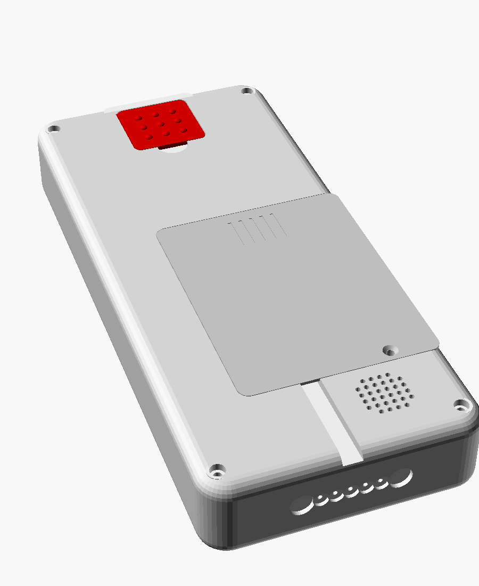
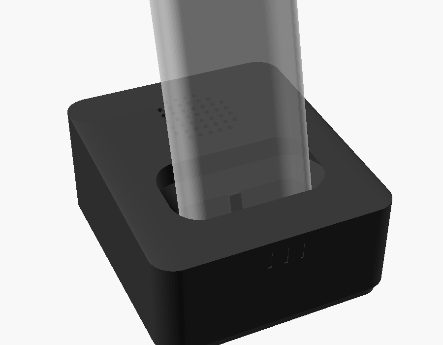

# Omafon – Software

[](https://github.com/2eno/omafon/actions/workflows/ci.yml)

[](LICENSE)

Sprechendes Telefon für Menschen mit starker Sehbehinderung.
Raspberry Pi Zero 2 W, Python 3 (asyncio), zwei Varianten:

| Variante | `backend:` | Netz | Hardware |
|---|---|---|---|
| Mobilfunk | `sim7600` | LTE, SMS, GPS | Waveshare SIM7600E-H 4G HAT |
| Festnetz | `sip` | Fritz!Box per WLAN (IP-Telefon), Anrufbeantworter, Telefonbuch | Ladeschale mit Lautsprecher, kein Modem |
| Hybrid | `hybrid` | zu Hause Fritz!Box, unterwegs LTE – automatisch | beides, größerer Akku ([docs/hybrid.md](docs/hybrid.md)) |

Festnetz: Recherche und Bewertung in [docs/festnetz-recherche.md](docs/festnetz-recherche.md),
Stückliste und Verkabelung in [docs/festnetz-hardware.md](docs/festnetz-hardware.md).


*Vorschau mit Ersatzschrift Liberation Sans; vorgesehen ist Atkinson Hyperlegible.*

| Handteil vorn | Handteil hinten | Ladeschale |
|---|---|---|
|  |  |  |

## Status

**Software im Simulator getestet, Hardware ungetestet.**

- Alle Tests laufen ohne Hardware (siehe CI); der PC-Simulator (`--sim`) deckt
  Wählen, Anrufe, SMS, Sprachwahl, Diktat und Notruf ab.
- Modem, Tastenmatrix, Verstärker, Akku-Messung und Gehäuseteile sind noch
  nicht an echter Hardware erprobt.
- **Komplettes Druckpaket:** Die CI erzeugt bei jedem Push alle STL-Dateien
  (Artefakt `omafon-stl`). Darin sind Tastenkappen ein- und zweifarbig, das Gehäuse
  und die Ladeschale je Variante sowie die Druck- und Montageanleitung
  ([docs/druckteile.md](docs/druckteile.md)). Gedruckt ist davon noch nichts.

## Neue Nachrichten

SMS werden **nicht automatisch vorgelesen**. Eine neue Nachricht wird mit einem
Gong angekündigt, der sich alle `news_signal_minutes` (Standard 10) wiederholt,
solange etwas ungelesen ist; zusätzlich blinkt die LED langsam (`news_led`).
Während eines Gesprächs oder in der Ruhezeit (`quiet_hours`) gibt es keinen
Gong, nachts nur die LED. Vorgelesen wird erst mit der Nachricht-Taste.

## Tasten

Die Kappen sind zweifarbig ausgelegt: Zeichen immer kontrastreich zur Kappe
(Schwarz auf Weiß, Schwarz auf Gelb, Weiß auf Schwarz/Rot). Farben stehen in
`FARBEN` in `cad/omafon_tasten.scad`, Export getrennt mit `-D 'farbteil="kappe"'`
bzw. `-D 'farbteil="zeichen"'`.

```
omafon/
  main.py       Start, Watchdog, PC-Simulator (--sim)
  phone.py      Zustandsautomat: Wählen, Anrufe, SMS, Diktat, Notruf
  telephony.py  Schnittstelle TelephonyBackend + Auswahl über config.yaml
  modem.py      Backend sim7600: AT-Treiber SIM7600 (+ SimModem)
  sip.py        Backend sip: baresip über ctrl_tcp, Fritz!Box, Verbindungsüberwachung
  sipsim.py     nachgebautes baresip + Fritz!Box für Tests und --sim
  hybrid.py     Backend hybrid: Fritz!Box + Mobilfunk, Routing, Sparmodus
  fritz.py      TR-064: Telefonbuch, Anrufbeantworter
  notify.py     Telegram/E-Mail statt SMS (Festnetz, optional)
  pdu.py        SMS im PDU-Modus: Umlaute, Emojis, lange SMS
  audio.py      Piper-Sprachausgabe mit Cache, Töne, TPA2016-Verstärker
  stt.py        Vosk-Spracherkennung (Namen + Diktat), optional Whisper-Server
  hardware.py   Tasten (MCP23017 + GPIO), Entprellung, Akku, Vibration
  numbers.py    "zwo" statt "zwei", Nummern in Gruppen, Uhrzeit
tools/prerender.py   feste Ansagen vorab erzeugen
cad/omafon_masse.scad      gemeinsame Maße Handteil/Ladeschale, Variante
cad/omafon_gehaeuse.scad   Handteil: Deckel, Wanne, Tastenplatte, Akkudeckel, Notrufklappe …
cad/omafon_tasten.scad     Tastenkappen und Tastenfront (OpenSCAD)
cad/omafon_ladeschale.scad Ladeschale mit Lautsprecher
systemd/omafon.service
tests/test_omafon.py       23 Tests (Kern, Mobilfunk), ohne Hardware
tests/test_festnetz.py     30 Tests (SIP-Backend, Fritz!Box, Ladeschale), ohne Hardware
tests/test_hybrid.py       15 Tests (Routing, Notruf, Zweitanruf, Sparmodus), ohne Hardware
docs/                      Stückliste, Verkabelung, Festnetz-Recherche und -Hardware
```

## Am PC ausprobieren (ohne Hardware)

```bash
pip install -r requirements-dev.txt     # nur PyYAML
python3 -m unittest discover -s tests -v
python3 -m omafon.main --config config.example.yaml --sim
```

Im Simulator tippst du Tasten (`0171`, `a` = Anrufen, `h` = Auflegen, `Lm` = Nachricht lang)
und Netzereignisse (`!ring +491711234567`, `!sms +491609876543 Hallo Mama`, `!sag maria`).

Festnetz-Variante im Simulator (echtes SIP-Backend gegen nachgebautes baresip):

```bash
python3 -m omafon.main --config config.festnetz.example.yaml --sim
```

Dort legt `!sms <nr>` eine Nachricht auf den Anrufbeantworter, `!wlan aus` / `!wlan an`
trennt die Fritz!Box (nach 10 s kommt „Keine Verbindung zur Fritzbox“),
`lade` / `ab` stellt das Telefon in die Schale bzw. hebt es ab.

Hybridgerät im Simulator: `--config config.hybrid.example.yaml --sim`, zusätzlich
`!mring <nr>` (Anruf auf die Handynummer), `!ab <nr>` (Anrufbeantworter),
`!netz aus` / `!netz an` (Funkloch). Bedienung und Regeln: [docs/hybrid.md](docs/hybrid.md).

## Festnetz auf dem Pi (zusätzlich zur Installation unten)

```bash
sudo apt install baresip ffmpeg python3-fritzconnection
```

Fritz!Box einrichten wie in [docs/festnetz-recherche.md](docs/festnetz-recherche.md#7-was-in-der-fritzbox-einzurichten-ist)
beschrieben, dann `config.festnetz.example.yaml` nach `/etc/omafon/config.yaml`
kopieren und die Platzhalter ersetzen. Omafon startet baresip selbst.

## Erster Test am Modem – VOR dem Gehäusebau

```bash
sudo apt install minicom
minicom -D /dev/ttyAMA0 -b 115200
AT+CPIN?            # SIM bereit?
AT+CSQ              # Empfang (10–31 gut)
AT+CNMP=38          # nur LTE erzwingen
ATD<eigene Handynummer>;   # klingelt es und hört man sich? -> VoLTE läuft
AT+CHUP
AT+CNMP=2           # zurück auf automatisch
```

Klappt der Anruf im LTE-only-Modus nicht, funktioniert das Telefon nur bis zur
2G-Abschaltung (Mitte/Ende 2028). Dann: anderen Anbieter testen, Modul-Firmware
aktualisieren oder beim SIMCom-Support nach dem passenden VoLTE-Profil fragen.

## Installation auf dem Pi

1. **Raspberry Pi OS Lite 64 Bit** flashen. `raspi-config`: I²C an, serielle
   Schnittstelle an, Login-Konsole darauf aus.
2. `/boot/firmware/config.txt` ergänzen:
   ```
   enable_uart=1
   dtoverlay=disable-bt
   dtparam=watchdog=on
   ```
   In `/etc/systemd/system.conf`: `RuntimeWatchdogSec=15` (Hardware-Watchdog).
3. Pakete:
   ```bash
   sudo apt install python3-serial python3-smbus2 python3-gpiozero python3-yaml \
                    alsa-utils espeak-ng
   sudo pip install --break-system-packages vosk
   ```
4. **Piper** (Sprachausgabe): Release `piper_linux_aarch64.tar.gz` aus dem
   Projekt rhasspy/piper nach `/opt/omafon/piper/` entpacken. Stimme
   `de_DE-thorsten-medium` (oder `-low`, schneller) aus `rhasspy/piper-voices` nach
   `/opt/omafon/voices/`. Probiere auch die Frauenstimmen `kerstin` und `ramona` –
   Oma entscheidet. *Hinweis:* Piper wird inzwischen als `piper1-gpl` weiterentwickelt;
   dessen Kommandozeile hat andere Optionen – dann `Audio.synth()` anpassen.
5. **Vosk-Modell** `vosk-model-small-de-0.15` nach `/opt/omafon/` entpacken.
6. Code nach `/opt/omafon`, Konfiguration nach `/etc/omafon/config.yaml`, Benutzer
   `omafon` anlegen (Gruppen audio, dialout, gpio, i2c), Datenpartition `/data`.
7. `sudo python3 -m tools.prerender /etc/omafon/config.yaml` – erzeugt alle festen Ansagen.
8. `sudo cp systemd/omafon.service /etc/systemd/system/ && sudo systemctl enable --now omafon`
9. Zum Schluss `raspi-config` → Performance → **Overlay File System** an. Das System
   ist dann schreibgeschützt und übersteht Stromausfälle. Nur `/data` bleibt beschreibbar.

## Namen für die Sprachwahl

Vosk erkennt nur Wörter aus seinem Wortschatz. Exotische Namen ("Zeno") fehlen
oft. Darum hat jeder Kontakt `spoken:` – dort Wörter eintragen, die Oma ohnehin
sagt: `sohn`, `tochter`, `enkel`, `doktor`. Mit `!sag` im Simulator testen,
auf dem Pi mit einem kurzen Python-Aufruf von `Recognizer.listen_name()`.

## Was noch fehlt / bewusst offen

- Bestätigung "Taste 1 drücken" beim Notruf-Empfänger (DTMF-Erkennung prüfen).
- Echte Lastmessung für die Akkulaufzeit.
- TPA2016-Registerwerte am echten Chip prüfen (Kommentar in `audio.py`).

## Lizenz

MIT – siehe [LICENSE](LICENSE).
