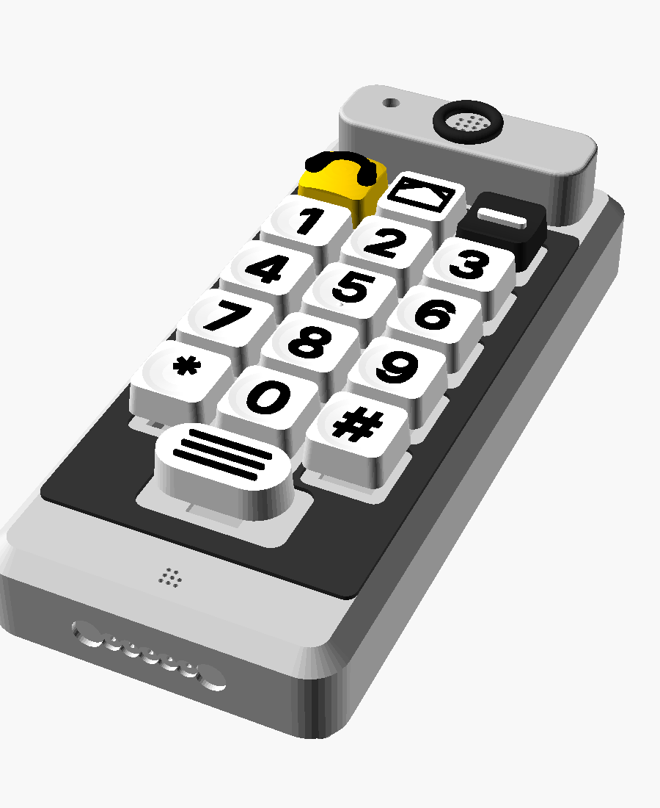
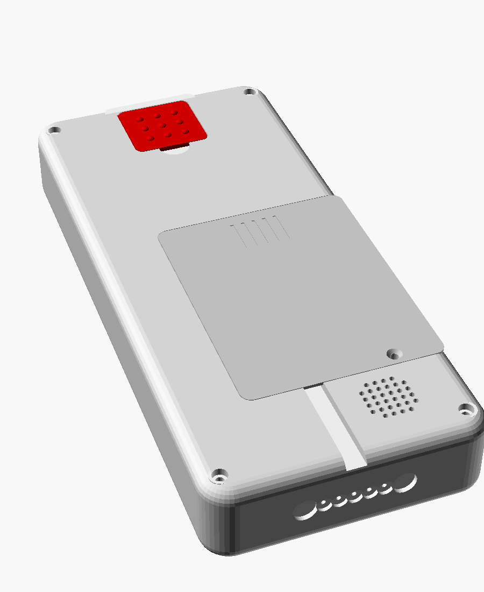

# Omafon – Druckteile und Zusammenbau

*[English](druckteile.md) · Deutsch*

Alle Teile sind parametrisch in OpenSCAD (`cad/`). Die CI rendert bei jedem Push
das **komplette Druckpaket** als Artefakt `omafon-stl`. Die STL-Dateien liegen dort
schon in Druckrichtung:

```
tasten/einfarbig/            17 Tastenkappen (Farbwechsel oder einfarbig)
tasten/zweifarbig/           dieselben Kappen als *_kappe.stl + *_zeichen.stl (Mehrmaterial)
gehaeuse/festnetz/           Handteil 94 x 210 x 30 mm
gehaeuse/hybrid/             Handteil 94 x 210 x 36 mm (Platz für den SIM7600-HAT)
                             (Hörerkopf + Muschel stehen 21 mm über der Vorderseite)
ladeschale/festnetz/         Ladeschale passend zum 30-mm-Handteil
ladeschale/hybrid/           Ladeschale passend zum 36-mm-Handteil
```




> **Stand:** Die Geometrie ist am Rechner geprüft: Kollisionen im Zusammenbau
> (auch mit gedrückten Tasten und der Elektronik als Platzhalter), Überhänge,
> Druckrichtung und fehlerfreies Rendern. **Gedruckt und anprobiert ist noch nichts.**
>
> **Reihenfolge:** erst das Prüfstück (Platte 0) und eine Tastenkappe, dann der
> Rest – siehe [Reihenfolge](#reihenfolge).

## Druckaufträge nach Einstellungen

Alles, was mit denselben Slicer-Einstellungen gedruckt wird, steht in einer Gruppe.
Innerhalb einer Gruppe sind die Teile nach Farbe auf **Druckplatten** verteilt, passend
für ein Druckbett ab 220 × 220 mm. Die STL liegen schon richtig herum; im Slicer
nur platzieren und, wo angegeben, um die Hochachse drehen – **nie kippen**. `<v>` = `festnetz` oder `hybrid`.

**Für alle Gruppen gilt:** keine Lochkompensation („Hole horizontal expansion“ = 0),
die Maße enthalten das Spiel schon (Taster-Ausschnitt 14,1 mm, Teile 0,3 mm je Seite).
Keine Stützen.

### Gruppe 1 – PETG, 0,2 mm (Gehäuse und Ladeschale)

| Einstellung | Wert |
|---|---|
| Material | PETG |
| Schichthöhe | **0,2 mm, auch die erste Lage** (Schalterplatten = 8 Lagen à 0,2 mm; andere Schichthöhen ergeben 1,4/1,8 mm, dann halten die Taster nicht) |
| Wände / oben / unten | 4 Wände, 5 Lagen oben, 5 Lagen unten |
| Füllung | 25 % Gyroid |
| Stützen / Haftung | keine / kein Brim |

| Platte | Datei | Stück | Farbe | Hinweis |
|---|---|---|---|---|
| **0 – zuerst** | `gehaeuse/<v>/pruefstueck.stl` | 1 | beliebig | ca. 20 min: Taster müssen fest einrasten, Einsatz einschmelzen, Lautstärketaste probestecken. Erst wenn das passt, weiterdrucken |
| **A – dunkel** | `gehaeuse/<v>/deckel.stl` | 1 | dunkelgrau/schwarz | Kontrast zu den weißen Kappen. Schalterplatte für 16 Taster eingebaut, Hörer mit Ringmulde, LED-Loch, Mikrofon |
| | `gehaeuse/<v>/tastengitter.stl` | 1 | wie Deckel | **optional:** 1,2 mm hohe Taststege, auf den Deckel kleben; gedrückte Kappen stoßen nicht an |
| | `gehaeuse/<v>/lautstaerke_plus.stl` | 1 | dunkel | erhabenes Kreuz |
| | `gehaeuse/<v>/lautstaerke_minus.stl` | 1 | dunkel | erhabener Balken |
| **B – hell** | `gehaeuse/<v>/wanne.stl` | 1 | hellgrau/weiß | Notrufmulde mit Schalterplatte, Akkufach, Ladekontakte, Kodiernut |
| | `gehaeuse/<v>/akkudeckel.stl` | 1 | wie Wanne | 2 Senkschrauben in 2,2-mm-Polstern |
| | `gehaeuse/<v>/hoererkopf.stl` | 1 | hell (LED gut sichtbar) | 18 mm hohes Kopfteil: Ohr und Muschel liegen gut 3 mm höher als die höchste Taste. **Um 90° drehen** und längs neben den Akkudeckel legen (76 × 24 mm). Platte B gesamt ca. 207 mm breit |
| **C – dunkel** | `ladeschale/<v>/schale.stl` | 1 | dunkel | Schacht, Trichter, Kodierrippe, Grill, USB-C-Halter (139 × 134 mm, Hybrid 139 × 140 mm, 58 mm hoch) |
| | `ladeschale/<v>/kontakttraeger.stl` | 1 | beliebig | 5 Federkontakte, 2 Magnete |
| **D** | `ladeschale/<v>/boden.stl` | 1 | beliebig | Gewichtskammer, Gummifüße (134 × 128 mm, Hybrid 134 × 134 mm) |

### Gruppe 2 – PETG, 0,2 mm, stehend mit Brim

Wie Gruppe 1, aber **Brim 5 mm**: Das Teil steht hochkant auf einer schmalen Kante.

| Platte | Datei | Stück | Farbe | Hinweis |
|---|---|---|---|---|
| **E – rot** | `gehaeuse/<v>/notrufklappe.stl` | 1 | rot | Noppen außen = „hier ist der Notruf“; Raste seitlich, Scharnier oben – fällt von selbst zu |

### Gruppe 3 – Tastenkappen, 0,12 mm

| Einstellung | Wert |
|---|---|
| Material | PETG oder PLA |
| Schichthöhe | **0,12 mm** (feine Kanten an den erhabenen Zeichen) |
| Wände / Füllung | 3 Wände, 30 % Füllung |
| Stützen / Haftung | keine / kein Brim; Oberseite oben |

17 Kappen: Ziffern 0–9, Stern, Raute, Nachricht, Info (weiß, Zeichen schwarz),
Anrufen (gelb, Zeichen schwarz), Auflegen (schwarz, Zeichen weiß), Notruf (rot,
Noppen weiß). **Erst eine Kappe drucken** und auf einen Taster stecken (Sitz:
`stem_spiel` in `cad/omafon_tasten.scad`).

| Platte | Dateien | Wann |
|---|---|---|
| **F – Mehrmaterial** | `tasten/zweifarbig/*_kappe.stl` + passendes `*_zeichen.stl` je Kappe als ein Objekt mit zwei Körpern laden | Drucker mit mehreren Farben (AMS, MMU, IDEX): beste Lesbarkeit |
| **F1 – weiß** | `tasten/einfarbig/` taste_0…9, taste_stern, taste_raute, nachricht, info | Ein-Düsen-Drucker. Nachricht und Info: Farbwechsel (M600) auf Höhe der Kappenoberkante. Ziffern sitzen in einer Mulde, dort das erhabene Zeichen danach mit Lackstift schwarz einfärben |
| **F2 – gelb** | `tasten/einfarbig/anrufen.stl` | Hörersymbol danach schwarz einfärben |
| **F3 – schwarz** | `tasten/einfarbig/auflegen.stl` | Balken danach weiß einfärben |
| **F4 – rot** | `tasten/einfarbig/notruf.stl` | Noppen bleiben rot (fühlbar genügt) |

### Gruppe 4 – TPU 95A

| Einstellung | Wert |
|---|---|
| Material | TPU 95A (weich); notfalls PETG wie Gruppe 1 |
| Schichthöhe | 0,2 mm |
| Füllung | 100 % |
| Geschwindigkeit | langsam, 20–25 mm/s; wenig Rückzug |

| Platte | Datei | Stück | Farbe | Hinweis |
|---|---|---|---|---|
| **G** | `gehaeuse/<v>/hoermuschel.stl` | 1 | dunkel | weicher Ring oben auf dem Hörerkopf: führt das Ohr und dichtet ab |

### Reihenfolge

Platte 0 (Prüfstück) und eine Kappe aus Gruppe 3 → A (Deckel) und Taster
anprobieren → B, E, G → restliche Kappen → C, D (Ladeschale).

### Allgemein

- **Material:** PETG ist zäher als PLA und verträgt Wärme in der Hand und am Fenster.
- **Bettgröße:** Deckel und Wanne sind 210 mm lang. Das passt auf Drucker ab
  220 × 220 mm bzw. auf 250 × 210 mm längs.

## Kaufteile für die Mechanik

| Teil | Stück | Wo |
|---|---|---|
| Gewindeeinsatz M2,5 × 3,5 (Einschmelzmutter, Ø 3,6 mm Loch) | 6 (+1 Prüfstück) | 4 im Deckel, 2 in den Akkudeckel-Domen |
| Zylinderschraube M2,5 × **25** (Festnetz) bzw. × **30** (Hybrid) | 4 | Gehäuse, von hinten (Senkung so tief, dass 3 mm im Einsatz greifen) |
| Senkschraube M2,5 × 6 | 2 | Akkudeckel |
| Schraube M2,5 × 6 (selbstformend) oder Abstandsbolzen | 4 | Pi Zero 2 W |
| Filament 1,75 mm, 32 mm lang | 1 | Scharnierstift Notrufklappe |
| Magnet 5 × 1 mm + Reedkontakt (Glas, 2 × 14 mm) oder Hallschalter | je 1 | Klappenschalter (GPIO 23) |
| Taster im Cherry-MX-Format | 17 | 16 Tasten + Notruf |
| Kurzhubtaster 6 × 6 mm + Lochraster 14 × 16 mm | je 2 | Lautstärke |
| Messingscheibe Ø 5 × 1 mm | 5 | Ladekontakte am Handteil |
| Stahlscheibe Ø 8 × 1,5 mm | 2 | Gegenstück zu den Magneten der Schale |
| Federkontakt (Pogo-Pin) Ø 2 mm, Magnet 8 × 3 mm | 5 / 2 | Ladeschale |
| Gummifüße Ø 10, Stahlscheiben 150–250 g, M3 × 8 | 4 / – / 2 | Ladeschale |

Elektronik siehe [stueckliste.md](stueckliste.md), Anschlüsse in
[verkabelung.md](verkabelung.md).

## Zusammenbau Handteil

1. **Einsätze** mit dem Lötkolben (ca. 220 °C) einschmelzen: 4 in die Dome des
   Deckels, 2 von außen in die Akkudeckel-Dome der Wanne.
2. **Taster:** 16 Taster von vorn in den Deckel klipsen (sie rasten in der 1,6-mm-
   Platte ein). Optional das Tastengitter vorn aufkleben. Kappen erst ganz am
   Schluss aufstecken.
3. Hörkapsel, Mikrofon (mit Dichtring/Filz) und LED in die Halter im Deckel kleben.
   LED von unten ins Lichtrohr des Hörerkopfs stecken (Kopf schaut oben heraus,
   Beine verlängern), Drähte durch das LED-Loch im Deckel. Hörerkopf mit 2K-Kleber
   auf den Deckel kleben; der Stummel des Schallrohrs zentriert ihn in der
   Ringmulde über dem Hörer. Hörmuschel oben in die Mulde des Kopfs kleben.
   Hybrid: GNSS-Antenne in den Rahmen oben rechts.
4. **Wanne:** Notruftaster von außen in die Mulde klipsen, Notrufkappe aufstecken.
   Reedkontakt in den Kanal neben der Mulde schieben, Magnet in die Klappe kleben
   (Tasche innen, Seite zum Reedkontakt), Klappe mit dem Filamentstift einhängen.
   Stift an beiden Enden kurz anschmelzen. Die Klappe rastet seitlich leicht ein.
5. Messingscheiben in die Unterkante kleben, Litzen durch die Löcher (von links:
   +5 V, GND, GND, LS+, LS−). Stahlscheiben daneben einkleben.
6. Lautsprecher in den Ring über dem Gitter kleben. Lautstärketasten von innen
   einsetzen, Lochraster-Platinen mit den 6×6-Tastern in die Schienen schieben.
7. Pi auf die Abstandshalter schrauben (Hybrid: HAT aufstecken,
   Schaumstoffpad zum Akku). Kleine Platinen mit Klebepads und Kabelbindern ins
   Feld rechts neben dem Akku.
8. Akku einlegen, Akkudeckel mit 2 Senkschrauben schließen.
9. Deckel aufsetzen (Falz zentriert), 4 Schrauben von hinten. Tastenkappen
   aufstecken.

## Zusammenbau Ladeschale

1. Federkontakte in den Kontaktträger pressen (Markierung = Kontakt 1, +5 V),
   Magnete einkleben (Polung so, dass sie die Stahlscheiben anziehen).
2. Kontaktträger in die Tasche am Schachtboden kleben.
3. Lautsprecher von unten an den Grill kleben, USB-C-Platine in die Nut schieben.
4. Stahlscheiben in die Gewichtskammer des Bodens kleben, Boden mit 2 × M3
   anschrauben, Gummifüße aufkleben.

## Anpassen

- Gemeinsame Maße von Handteil und Schale (Breite, Länge, Dicke je Variante,
  Kontakte, Kodierung) stehen in **`cad/omafon_masse.scad`**. Wer dort etwas ändert,
  muss Gehäuse **und** Schale neu exportieren.
- Einbauteile (Hörkapsel, Mikrofon, Lautsprecher, Akku, Einsätze) sind oben in
  `cad/omafon_gehaeuse.scad` einstellbar, z. B.
  `openscad -D 'variante="hybrid"' -D 'teil="wanne"' -D 'ls_d=31.6' …`.
- Kappe zu stramm auf dem Taster: `stem_spiel` in `omafon_tasten.scad`.

## Offene Punkte

1. Nichts davon ist gedruckt. Toleranzen (Spiel 0,3 mm, Taster-Ausschnitt 14,1 mm,
   Kappenstößel) mit dem Prüfstück und einer Kappe am eigenen Drucker prüfen.
   Anpassbar über `spalt`, `mx_ausschnitt` (Gehäuse) und `stem_spiel` (Kappen).
2. Das Handteil ist mit 94 × 210 mm groß. Das folgt aus dem 24-mm-Raster der Tasten.
   Kleiner geht nur mit engerem Raster (`raster` in `omafon_tasten.scad`).
   Schwerer zu treffen, aber leichter in der Hand. Gewicht geschätzt 250–350 g.
3. Akkumaße sind Beispiele (3000 mAh 60 × 75 × 10, 5000 mAh 60 × 70 × 12). Den
   echten Akku nachmessen und `AK` anpassen.
4. Der Notruf sitzt hinten (wie bei Seniorenhandys üblich). Liegt das Telefon auf
   dem Rücken, muss Oma es erst anheben. In der Schale ist die Klappe von hinten
   oben erreichbar. Mit ihr ausprobieren.
