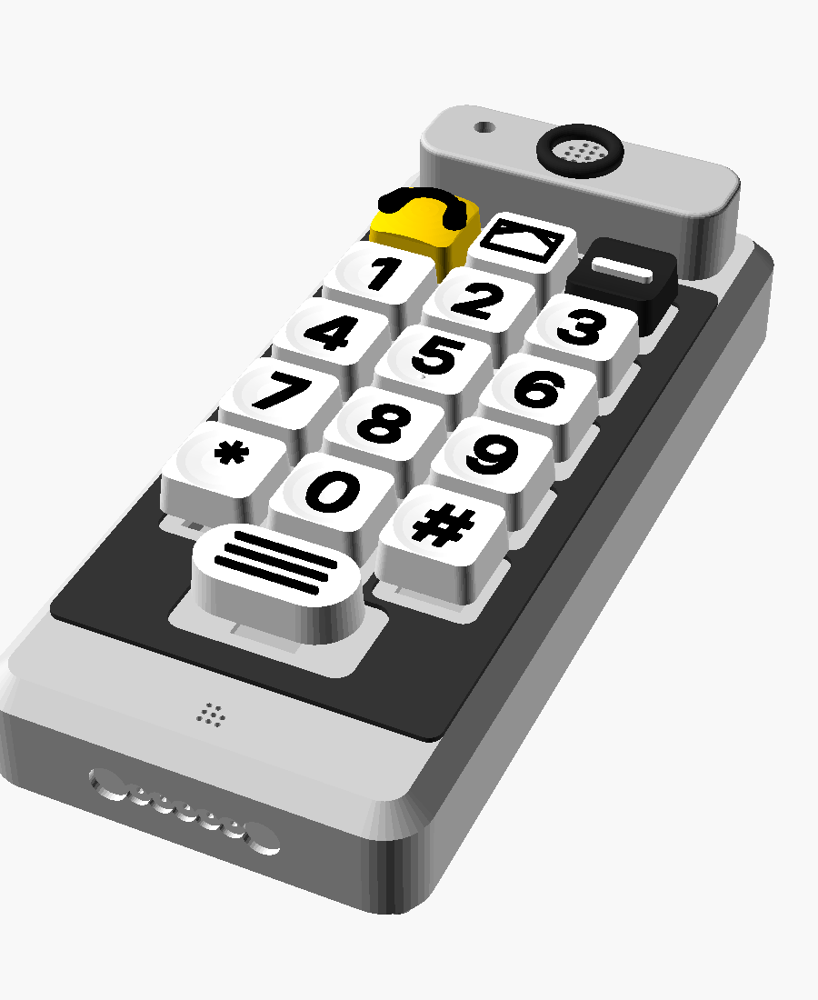
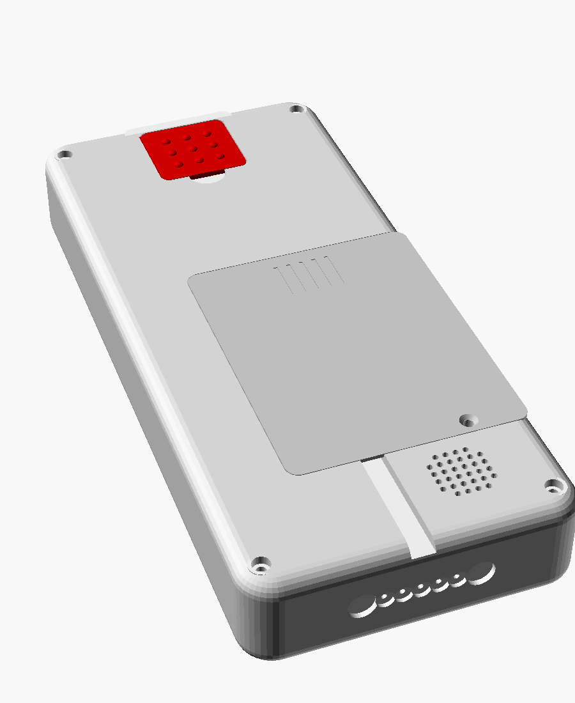

# Omafon – printed parts and assembly

*English · [Deutsch](druckteile.de.md)*

All parts are parametric in OpenSCAD (`cad/`). On every push, CI renders the
**complete print package** as the artifact `omafon-stl`. The STL files in it are
already in print orientation (the folder and file names are German):

```
tasten/einfarbig/            17 key caps (color change or single color)
tasten/zweifarbig/           the same caps as *_kappe.stl + *_zeichen.stl (multi-material)
gehaeuse/festnetz/           handset 94 x 210 x 30 mm (landline)
gehaeuse/hybrid/             handset 94 x 210 x 36 mm (room for the SIM7600 HAT)
                             (head part + ear cup stand 21 mm above the front)
ladeschale/festnetz/         cradle matching the 30 mm handset
ladeschale/hybrid/           cradle matching the 36 mm handset
```




> **Status:** the geometry has been checked on the computer: collisions in the
> assembly (also with pressed keys and the electronics as placeholders), overhangs,
> print orientation and error-free rendering. **Nothing has been printed or fitted yet.**
>
> **Order:** first the test piece (plate 0) and one key cap, then the rest – see
> [Order](#order).

## Print jobs by settings

Everything printed with the same slicer settings is in one group. Within a group the
parts are distributed by color onto **build plates**, sized for a bed of 220 × 220 mm
or more. The STLs are already the right way up; in the slicer only place them and, where
stated, rotate them around the vertical axis – **never tilt them**. `<v>` = `festnetz` or
`hybrid`.

**For all groups:** no hole compensation (“hole horizontal expansion” = 0); the
dimensions already contain the clearance (switch cut-out 14.1 mm, parts 0.3 mm per side).
No supports.

### Group 1 – PETG, 0.2 mm (housing and cradle)

| Setting | Value |
|---|---|
| Material | PETG |
| Layer height | **0.2 mm, including the first layer** (switch plates = 8 layers of 0.2 mm; other layer heights give 1.4/1.8 mm, and then the switches don’t hold) |
| Walls / top / bottom | 4 walls, 5 top layers, 5 bottom layers |
| Infill | 25 % gyroid |
| Supports / adhesion | none / no brim |

| Plate | File | Qty | Color | Note |
|---|---|---|---|---|
| **0 – first** | `gehaeuse/<v>/pruefstueck.stl` | 1 | any | approx. 20 min: switches must snap in firmly, heat-set the insert, test-fit the volume key. Only continue printing once it fits |
| **A – dark** | `gehaeuse/<v>/deckel.stl` | 1 | dark grey/black | contrast to the white caps. Built-in switch plate for 16 switches, earpiece with ring recess, LED hole, microphone |
| | `gehaeuse/<v>/tastengitter.stl` | 1 | like the top | **optional:** 1.2 mm high tactile ridges, glued onto the top; pressed caps don’t touch them |
| | `gehaeuse/<v>/lautstaerke_plus.stl` | 1 | dark | raised cross |
| | `gehaeuse/<v>/lautstaerke_minus.stl` | 1 | dark | raised bar |
| **B – light** | `gehaeuse/<v>/wanne.stl` | 1 | light grey/white | emergency recess with switch plate, battery bay, charging contacts, coding groove |
| | `gehaeuse/<v>/akkudeckel.stl` | 1 | like the bottom shell | 2 countersunk screws in 2.2 mm pads |
| | `gehaeuse/<v>/hoererkopf.stl` | 1 | light (LED clearly visible) | 18 mm high head part: ear and ear cup sit a good 3 mm higher than the highest key. **Rotate by 90°** and place it lengthwise next to the battery cover (76 × 24 mm). Plate B approx. 207 mm wide in total |
| **C – dark** | `ladeschale/<v>/schale.stl` | 1 | dark | slot, funnel, coding rib, grille, USB-C holder (139 × 134 mm, hybrid 139 × 140 mm, 58 mm high) |
| | `ladeschale/<v>/kontakttraeger.stl` | 1 | any | 5 spring contacts, 2 magnets |
| **D** | `ladeschale/<v>/boden.stl` | 1 | any | weight chamber, rubber feet (134 × 128 mm, hybrid 134 × 134 mm) |

### Group 2 – PETG, 0.2 mm, standing with brim

Like group 1, but **brim 5 mm**: the part stands upright on a narrow edge.

| Plate | File | Qty | Color | Note |
|---|---|---|---|---|
| **E – red** | `gehaeuse/<v>/notrufklappe.stl` | 1 | red | nubs outside = “this is the emergency button”; detent at the sides, hinge at the top – closes by itself |

### Group 3 – key caps, 0.12 mm

| Setting | Value |
|---|---|
| Material | PETG or PLA |
| Layer height | **0.12 mm** (fine edges on the raised symbols) |
| Walls / infill | 3 walls, 30 % infill |
| Supports / adhesion | none / no brim; top side up |

17 caps: digits 0–9, star, hash, message, info (white, symbols black), call (yellow,
symbol black), hang up (black, symbol white), emergency (red, nubs white). **Print one
cap first** and put it on a switch (fit: `stem_spiel` in `cad/omafon_tasten.scad`).

| Plate | Files | When |
|---|---|---|
| **F – multi-material** | load `tasten/zweifarbig/*_kappe.stl` + the matching `*_zeichen.stl` per cap as one object with two bodies | printers with several colors (AMS, MMU, IDEX): best legibility |
| **F1 – white** | `tasten/einfarbig/` taste_0…9, taste_stern, taste_raute, nachricht, info | single-nozzle printers. Message and info: color change (M600) at the height of the cap top edge. Digits sit in a dish; color the raised symbol black afterwards with a paint marker |
| **F2 – yellow** | `tasten/einfarbig/anrufen.stl` | color the handset symbol black afterwards |
| **F3 – black** | `tasten/einfarbig/auflegen.stl` | color the bar white afterwards |
| **F4 – red** | `tasten/einfarbig/notruf.stl` | the nubs stay red (feeling them is enough) |

### Group 4 – TPU 95A

| Setting | Value |
|---|---|
| Material | TPU 95A (soft); PETG like group 1 if necessary |
| Layer height | 0.2 mm |
| Infill | 100 % |
| Speed | slow, 20–25 mm/s; little retraction |

| Plate | File | Qty | Color | Note |
|---|---|---|---|---|
| **G** | `gehaeuse/<v>/hoermuschel.stl` | 1 | dark | soft ring on top of the head part: guides the ear and seals |

### Order

Plate 0 (test piece) and one cap from group 3 → A (top) and test-fit the switches →
B, E, G → remaining caps → C, D (cradle).

### General

- **Material:** PETG is tougher than PLA and tolerates warmth in the hand and on a
  windowsill.
- **Bed size:** top and bottom shell are 210 mm long. That fits printers from
  220 × 220 mm or 250 × 210 mm lengthwise.

## Purchased parts for the mechanics

| Part | Qty | Where |
|---|---|---|
| Threaded insert M2.5 × 3.5 (heat-set nut, Ø 3.6 mm hole) | 6 (+1 test piece) | 4 in the top, 2 in the battery cover bosses |
| Cylinder head screw M2.5 × **25** (landline) or × **30** (hybrid) | 4 | housing, from the back (counterbore deep enough that 3 mm engage in the insert) |
| Countersunk screw M2.5 × 6 | 2 | battery cover |
| Screw M2.5 × 6 (thread-forming) or standoffs | 4 | Pi Zero 2 W |
| Filament 1.75 mm, 32 mm long | 1 | hinge pin of the emergency cover |
| Magnet 5 × 1 mm + reed contact (glass, 2 × 14 mm) or Hall switch | 1 each | cover switch (GPIO 23) |
| Cherry MX format switches | 17 | 16 keys + emergency |
| Tactile switch 6 × 6 mm + perfboard 14 × 16 mm | 2 each | volume |
| Brass disc Ø 5 × 1 mm | 5 | charging contacts on the handset |
| Steel disc Ø 8 × 1.5 mm | 2 | counterpart to the cradle magnets |
| Spring contact (pogo pin) Ø 2 mm, magnet 8 × 3 mm | 5 / 2 | cradle |
| Rubber feet Ø 10, steel discs 150–250 g, M3 × 8 | 4 / – / 2 | cradle |

Electronics see [stueckliste.md](stueckliste.md), connections in
[verkabelung.md](verkabelung.md).

## Handset assembly

1. **Inserts:** heat-set them with a soldering iron (approx. 220 °C): 4 into the bosses
   of the top, 2 from the outside into the battery cover bosses of the bottom shell.
2. **Switches:** clip 16 switches into the top from the front (they snap into the
   1.6 mm plate). Optionally glue the tactile grid on the front. Only put the caps on
   at the very end.
3. Glue the earpiece, microphone (with sealing ring/felt) and LED into the holders in the
   top. Push the LED from below into the light pipe of the head part (the head looks out
   at the top, extend the legs), wires through the LED hole in the top. Glue the head
   part onto the top with 2-part adhesive; the stub of the sound tube centers it in the
   ring recess above the earpiece. Glue the ear cup into the recess on top of the head.
   Hybrid: GNSS antenna into the frame at the top right.
4. **Bottom shell:** clip the emergency switch into the recess from the outside, put on
   the emergency cap. Slide the reed contact into the channel next to the recess, glue
   the magnet into the cover (pocket inside, side towards the reed contact), hang the
   cover with the filament pin. Briefly melt both ends of the pin. The cover snaps in
   lightly at the sides.
5. Glue the brass discs into the bottom edge, wires through the holes (from the left:
   +5 V, GND, GND, SPK+, SPK−). Glue the steel discs in next to them.
6. Glue the speaker into the ring above the grille. Insert the volume keys from the
   inside, slide the perfboards with the 6×6 switches into the rails.
7. Screw the Pi onto the standoffs (hybrid: plug on the HAT, foam pad towards the
   battery). Small boards with adhesive pads and cable ties into the area to the right
   of the battery.
8. Insert the battery, close the battery cover with 2 countersunk screws.
9. Put on the top (the lip centers it), 4 screws from the back. Put on the key caps.

## Cradle assembly

1. Press the spring contacts into the contact carrier (mark = contact 1, +5 V), glue in
   the magnets (polarity such that they attract the steel discs).
2. Glue the contact carrier into the pocket in the slot floor.
3. Glue the speaker to the grille from below, slide the USB-C board into the groove.
4. Glue steel discs into the weight chamber of the base, screw on the base with
   2 × M3, stick on the rubber feet.

## Adjusting

- Shared dimensions of handset and cradle (width, length, thickness per variant,
  contacts, coding) are in **`cad/omafon_masse.scad`**. Anyone changing something there
  has to re-export the housing **and** the cradle.
- Built-in parts (earpiece, microphone, speaker, battery, inserts) can be set at the top
  of `cad/omafon_gehaeuse.scad`, e.g.
  `openscad -D 'variante="hybrid"' -D 'teil="wanne"' -D 'ls_d=31.6' …`.
- Cap too tight on the switch: `stem_spiel` in `omafon_tasten.scad`.

## Open points

1. None of this has been printed. Check the tolerances (clearance 0.3 mm, switch cut-out
   14.1 mm, cap stem) with the test piece and one cap on your own printer. Adjustable
   via `spalt`, `mx_ausschnitt` (housing) and `stem_spiel` (caps).
2. At 94 × 210 mm the handset is large. That follows from the 24 mm key grid. Smaller
   is only possible with a tighter grid (`raster` in `omafon_tasten.scad`) – harder to
   hit, but easier to hold. Estimated weight 250–350 g.
3. The battery dimensions are examples (3000 mAh 60 × 75 × 10, 5000 mAh 60 × 70 × 12).
   Measure the real battery and adjust `AK`.
4. The emergency button sits at the back (as usual for senior phones). If the phone lies
   on its back, grandma has to lift it first. In the cradle, the cover can be reached
   from the top rear. Try it out with her.
